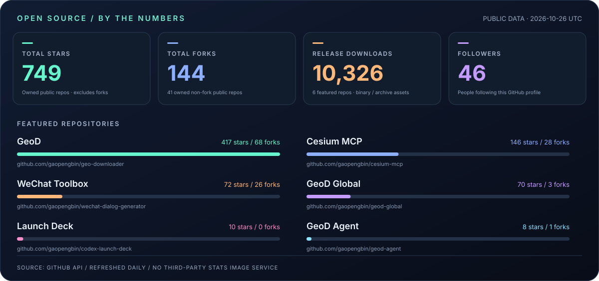
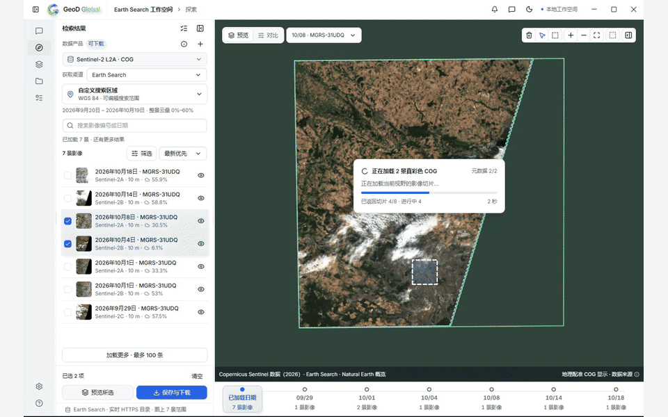
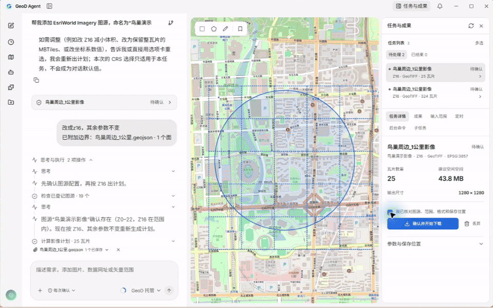
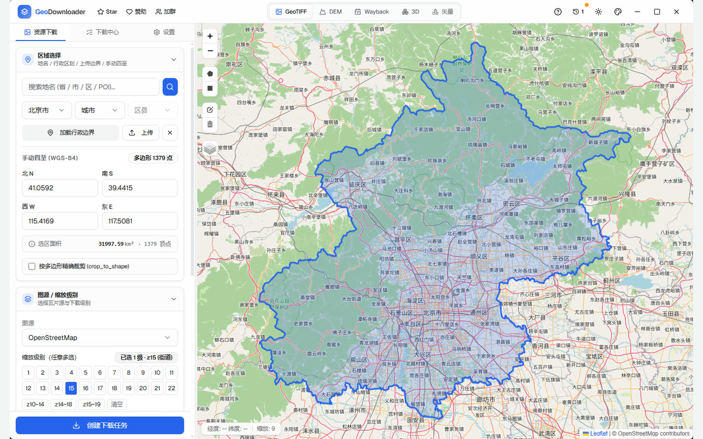
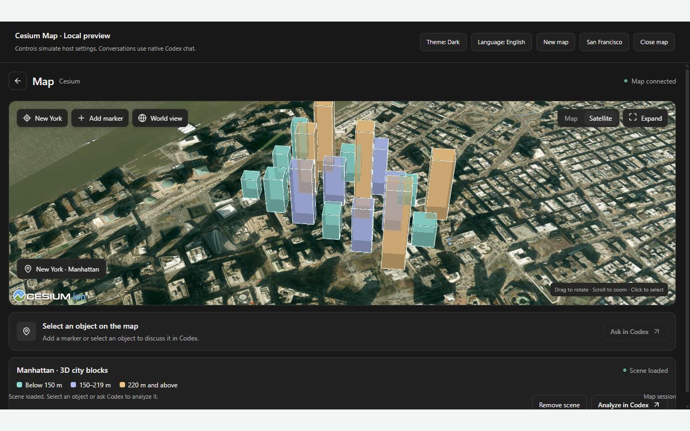
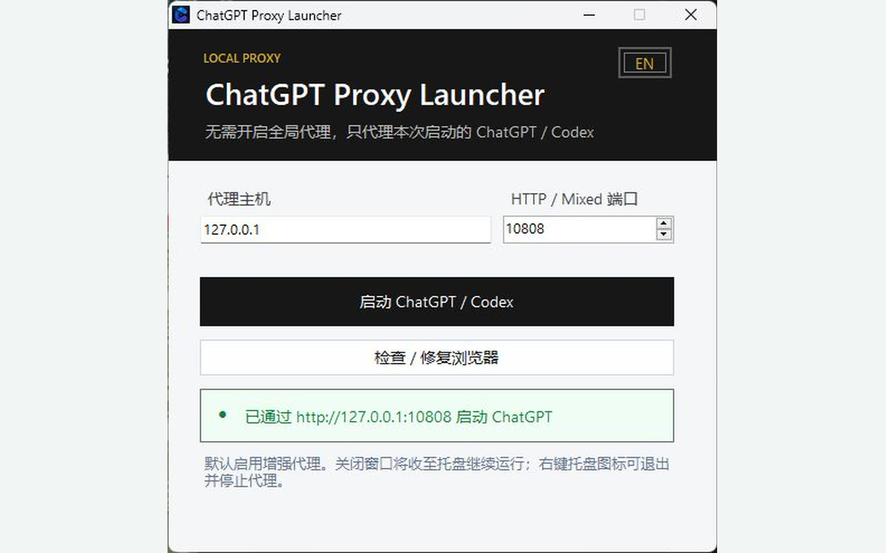
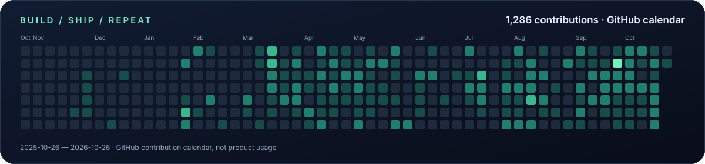

<a href="#numbers">数据仪表板</a> &nbsp; / &nbsp; <a href="#featured-products">产品现场</a> &nbsp; / &nbsp; <a href="#more-projects">更多作品</a> &nbsp; / &nbsp; <a href="#open-source">开源贡献</a> &nbsp; / &nbsp; <a href="#contact">联系我</a>

数据口径 · 公开可核查，每日自动更新

- Stars / Forks：`gaopengbin` 自有公开、非 Fork 仓库之和；不是用户数。
- Downloads：六个主推仓库现存公开 Releases 中安装包和压缩包资产的累计下载计数，包含预发行；不包含源码克隆、npm、网站或 CDN 下载，不代表独立用户或成功安装次数。
- Followers：GitHub 账号关注者。项目进度条按六个主推仓库的 Stars 相对比例展示，不是增长率。
- 数据直接来自 GitHub API，更新时间为 UTC；请求失败会保留上一份有效数据，不填假零。快照：[原始统计](./assets/profile-metrics.json) · [更新任务](https://github.com/gaopengbin/gaopengbin/actions/workflows/profile-metrics.yml)。

## Selected work · 看得见的产品

实机截图与演示片段。点击图片查看完整演示或高清截图。

标准徽章来自 Shields.io：Stars / Forks / Downloads。徽章下载量统计全部 GitHub Release 资产（含校验文件），总览只统计安装包与压缩包；不同缓存更新时间可能略有差异，均不代表用户数。

<table>
<tr>
<td width="50%" valign="top">

### 01 / GeoD Global

**遥感影像与地理数据，一个工作区。**

按区域检索、预览和下载数据，用自己的模型组织 Agent 任务。

[官网 ↗](https://geod-global.laogao.xyz/) · [源码](https://github.com/gaopengbin/geod-global) · [下载](https://geod-global.laogao.xyz/index.html#download) · [高清截图](./assets/geod-global.jpg)

实机片段 · Windows · Rust / Tauri · STAC
</td>
<td width="50%" valign="top">

### 02 / GeoD Agent

**从一句需求，到本机执行与成果核验。**

对话配置图源、下载与处理；支持二维 / 三维地图、Skill 和 MCP。

[官网 ↗](https://geod.laogao.xyz/agent) · [源码](https://github.com/gaopengbin/geod-agent) · [下载](https://github.com/gaopengbin/geod-agent/releases/latest) · [高清截图](./assets/geod-agent.jpg)

实机片段 · Windows · Local Execution · MCP
</td>
</tr>
<tr>
<td width="50%" valign="top">

### 03 / GeoD

**跨平台地理数据下载、处理与导出。**

地图影像、GeoTIFF、矢量瓦片、3D Tiles 与历史影像，覆盖桌面、CLI 和 MCP。

[官网 ↗](https://geod.laogao.xyz/) · [源码](https://github.com/gaopengbin/geo-downloader) · [下载](https://github.com/gaopengbin/geo-downloader/releases/latest)

应用截图 · Windows / macOS / Linux
</td>
<td width="50%" valign="top">

### 04 / Cesium MCP

**让 AI 操作真实的 CesiumJS 三维场景。**

共享工具契约与独立控制运行时，连接 MCP、WebMCP 和 Browser Agent。

[文档 ↗](https://gaopengbin.github.io/cesium-mcp/) · [源码](https://github.com/gaopengbin/cesium-mcp) · [npm](https://www.npmjs.com/package/cesium-mcp-runtime)

示例场景截图 · TypeScript · CesiumJS
</td>
</tr>
<tr>
<td width="50%" valign="top">

### 05 / 微信创作工具箱

**在线制作微信模拟图，支持批量导出。**

聊天、朋友圈、转账与红包等场景。免登录编辑预览，导出需登录。

[立即使用 ↗](https://chat.laogao.xyz/) · [源码](https://github.com/gaopengbin/wechat-dialog-generator)

线上实拍 · 示例对话 · 长图 / 批量 ZIP
</td>
<td width="50%" valign="top">

### 06 / Codex Launch Deck

**让 Windows 上的 Codex 启动更顺手。**

便携版提供应用级代理启动、增强代理与运行诊断，不修改系统代理。

[查看项目 ↗](https://github.com/gaopengbin/codex-launch-deck) · [下载安装](https://github.com/gaopengbin/codex-launch-deck/releases/latest)

便携版窗口实拍 · Windows · App-scoped Proxy
</td>
</tr>
</table>

画面来自公开产品演示与实际应用；版本界面可能有差异。地理数据需具备相应访问与使用权限。

<b>More projects · 更多作品与探索</b>

 

| 产品 | 用途 | 入口 |
| :--- | :--- | :--- |
| **CodeDrobe** | AI 桌面应用可逆主题与主题商店，兼容性以应用和版本为准 | [官网](https://codedrobe.app/) · [源码](https://github.com/CodeDrobe/core) |
| **GeoStyle** `内测` | 参考图与文字驱动的 AI 制图、可编辑样式 | [作品](https://geostyle.laogao.xyz/) · [展示仓库](https://github.com/gaopengbin/geostyle-showcase) |
| **微信同传** | 本地写作、Markdown 排版与公众号草稿同步；不自动发布 | [WeChat Writer](https://github.com/gaopengbin/wechat-writer) |
| **GaiaAgent** | LLM + CesiumJS 三维空间智能工作台 | [源码](https://github.com/gaopengbin/GaiaAgent) |
| **Spatial MCP Toolkit** | 不同地图引擎的 AI 控制工具 | [Mapbox](https://github.com/gaopengbin/mapbox-mcp) · [OpenLayers](https://github.com/gaopengbin/openlayers-mcp) · [Leaflet](https://github.com/gaopengbin/leaflet-mcp) |
| **OpenStyle** `实验` | 结构化地图样式、编译与 AI 制图工具链 | [源码](https://github.com/gaopengbin/openstyle) |

## Built in the open · 开源贡献

持续参与 [Cesium 官方 AI 集成生态](https://github.com/CesiumGS/cesium-ai-integrations)。已合并：

[社区集成 #21](https://github.com/CesiumGS/cesium-ai-integrations/pull/21) &nbsp; / &nbsp; [影像服务 #22](https://github.com/CesiumGS/cesium-ai-integrations/pull/22) &nbsp; / &nbsp; [地形服务 #30](https://github.com/CesiumGS/cesium-ai-integrations/pull/30) &nbsp; / &nbsp; [统一 MCP 网关 #39](https://github.com/CesiumGS/cesium-ai-integrations/pull/39)

## Let's build · 认识一下

我是 **老高 / 高鹏彬**，在北京，约 6 年软件开发经验。关注 **AI 应用、Agent、开发者工具与产品工程**，也把地理空间领域的经验带进真实产品。

`TypeScript` `React` `Vue` `Node.js` `Rust` `Tauri` `Python`

欢迎产品反馈、开源协作，以及 AI 应用 / Agent / 全栈开发机会。

[邮件联系](mailto:1804287165@qq.com) · [简历 PDF](https://laogao.xyz/platform-api/public/resume/gaopengbin-ai-20260906.pdf) · 公众号 **老高 Vibe Coding** · 微信 `laogaovibecoding`
